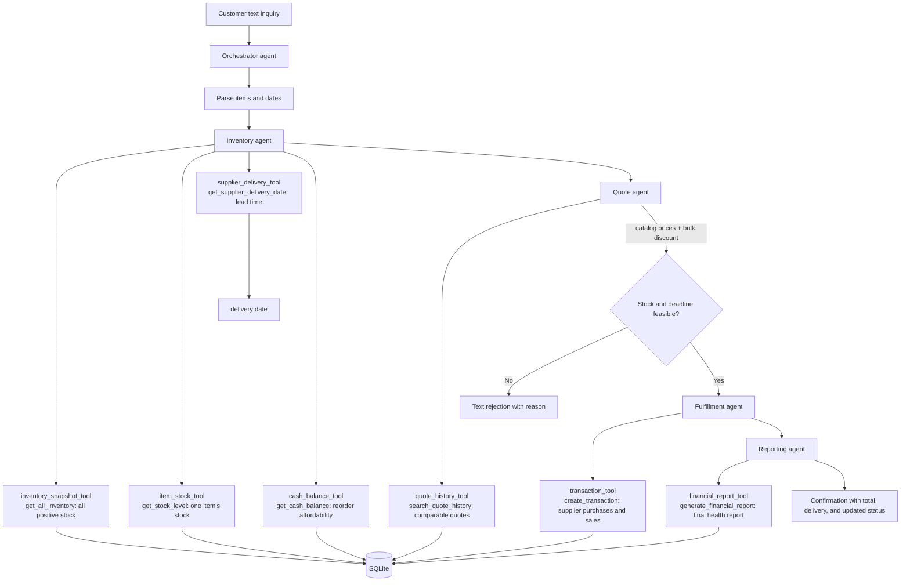

# Munder Difflin agent flow

There are five agents: Orchestrator, Inventory, Quote, Fulfillment, and Reporting.
The implementation uses the `smolagents` tool decorator. Agents communicate
through typed Python records and customer-facing text; database access is
restricted to the decorated tools, each of which delegates to a supplied starter
helper. The orchestrator delegates in this order: parse -> inventory -> quote ->
decision -> fulfillment -> reporting.
