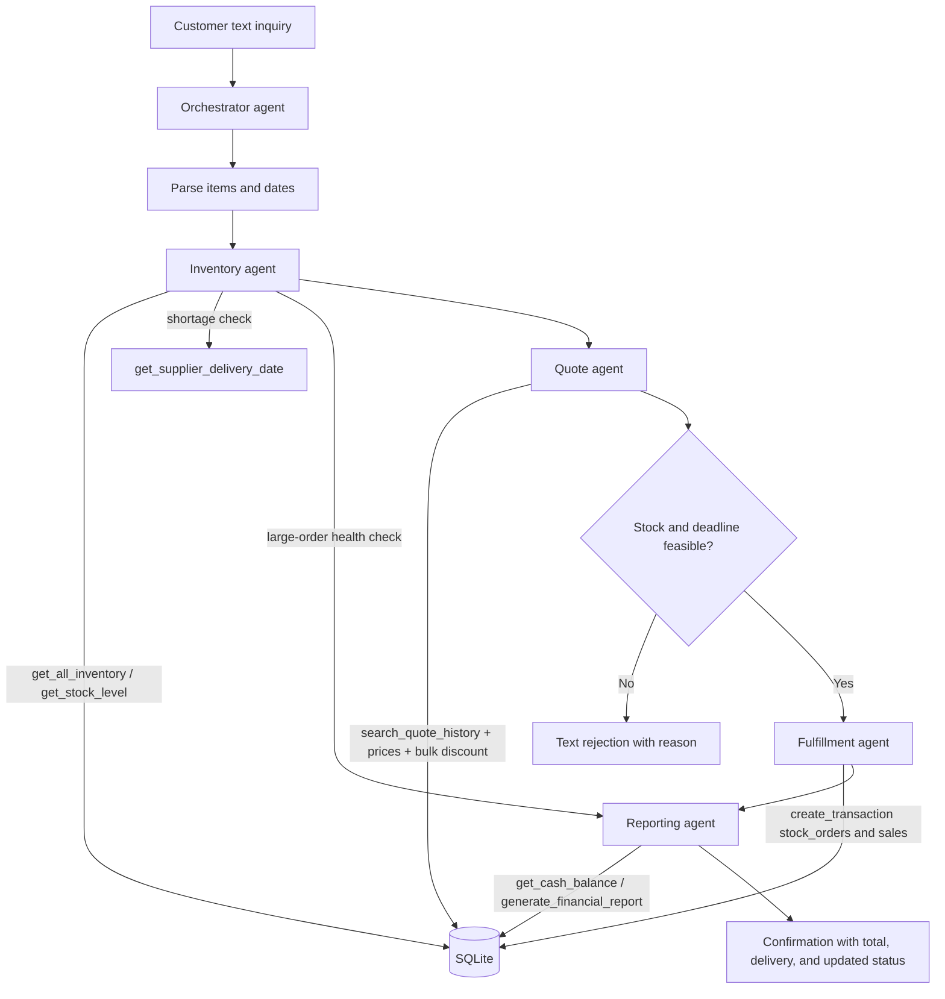

# Munder Difflin agent flow

There are five agents: Orchestrator, Inventory, Quote, Fulfillment, and Reporting.
Agents communicate through typed Python records and customer-facing text; database
access is restricted to the supplied helper functions.
